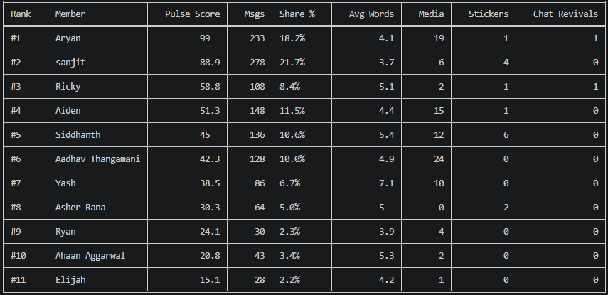

# GroupPulse Research Notebook
**Project Title:** Longitudinal Analysis of Small-Group Dynamics and Social Hierarchies in Digital Messaging Networks  
**Principal Investigator:** Rikhav (Ricky) Patil
**Target Study Duration:** 365 Days  
**Primary Dataset:** WhatsApp Group Chat (el mandemo, 11 active members)  
**Research Questions:** Who really holds the real power in a group chat, how does that social ranking change over a full year, and can a computer accurately measure social influence using message data alone?
**Hypothesis:** Informal power hierarchies in long-lasting online friend groups are not random, can be measured mathematically through messaging data alone, and remain stable unless disrupted by major real-world events.

---

## Day 1: Initial Execution
**Date:** October 11, 2026
**Coding Time:** 1 hour 19 minutes  
**Objective**: Build a 24/7 system that automatically captures messages and saves chat group data in real time without slowing anything down or losing messages.

### Materials and Protocols
* Our runtime environment is Node.js v24.16.0 on Windows 11 (x86_64)
* The libraries/dependencies we used are `whatsapp-web.js` (v1.23.0), `qrcode-terminal` (v0.12.0), `fs` (Node core module)
* Our Execution Binary is Google Chrome (x86) located at `C:\Program Files (x86)\Google\Chrome\Application\chrome.exe`
* **Protocols Followed:** Standard WebSockets connection handling via Chromium automation; local session authentication via `LocalAuth` strategy.

### Execution and Observations
* 09:15 AM CT: Initialized Node project directory (GroupPulse). Attempted dependency installation using npm install whatsapp-web.js qrcode-terminal.
* 09:30 AM CT: Installation failed with EPERM permission error during Puppeteer browser binary extraction. Observed OneDrive file-locking conflicts in node_modules.
* 09:45 AM CT: Resolved by deleting local node_modules. Corrected resolution: Set environment variable PUPPETEER_SKIP_DOWNLOAD=true and pointed execution path directly to pre-installed system Google Chrome binary.
* 10:10 AM CT: Constructed index.js incorporating LocalAuth session storage and message_create event handlers.
* 10:30 AM CT: Launched node index.js. Generated terminal QR code and scanned via mobile WhatsApp client.
* 12:04 PM CT: Execution crashed due to unhandled promise rejection during rapid initial sync (r: r execution context error).
* 12:15 PM CT: Updated index.js to wrap DOM queries (getChat(), getContact()) in asynchronous .catch(() => null) error boundaries and added global process exception handlers (uncaughtException, unhandledRejection).
* 12:20 PM CT: Relaunched script. Successfully connected without QR re-scan due to cached LocalAuth credentials. Active event logging verified.

### Results and Raw Data
* **Data File Location:** `C:\Users\rikha\OneDrive\Desktop\Python Projects\GroupPulse\messages.jsonl`
* **Target Group:** "el mandemo" (`groupId`: ending in `@g.us`)
* **Storage Protocol:** JSON Lines (JSONL), synchronous write (`fs.appendFileSync`)
* **Data Schema:** Each entry captures `timestamp`, `groupId`, `groupName`, `sender`, `senderId`, `body`, `type`, `hasMedia`, `isForwarded`, `mentionedIds`, `hasQuotedMsg`, and `quotedMsgId`.

### Analysis, Interpretation, and Next Steps
* The ingestion pipline successfully established persistent WebSocket logging
* Local session caching (`LocalAuth`) functions across process restarts
* Exception handling prevents fatal process termination during malformed or rpaid message events.
* **To-Do / Action Items:**
  1. Maintain active script execution to aggregate 24 hours of baseline messaging data.
  2. Develop a secondary Python data processing script (`analyze.py`) to parse raw JSONL data.
  3. Ensure raw `.jsonl` files and `.wwebjs_auth` session keys remain excluded from public version control via `.gitignore`.

---

## Day 2: Baseline Metrics
* **Date:** October 12, 2026
* **Coding Time**: 1 hour 20 minutes
* **Objective**: Execute initial exploratory data analysis (EDA) using custom Python analytics (analyze.py) on the first 26.6-hour observation window.

### Materials and Protocols
* **Runtime Environment:** Python 3.x
* **Libraries/Dependencies:** `pandas`, `tabulate`, `datetime`, `collections`
* **Data Source:** `messages.jsonl` (accumulated over ~26.6 hours of continuous runtime)
* **Protocols Followed:** Standard Pandas DataFrame parsing and aggregation; custom metric weighting formula for Pulse Score calculation:
  $$\text{Pulse Score} = f(\text{Volume Share}, \text{Silence Revival Count}, \text{Engagement/Reply Rate})$$

### Execution and Observations
* **2:10 PM CT**: Installed processing dependencies using pip install pandas tabulate.
* **2:25 PM CT**: Authored analyze.py script to read messages.jsonl line-by-line, parse JSON objects, standardise timestamps to UTC, and load into a Pandas DataFrame.
* **2:40 PM CT**: Implemented logic to detect "Chat Revivals" (defined as a new message sent after a gap of ≥ 90 minutes of group inactivity).
* **2:50 PM CT**: Calculated per-user metrics: Total Messages, Volume Share %, Average Words per Text Message, Media Items, Stickers, and Chat Revivals.
* **03:00 PM CT**: Executed python analyze.py. Evaluated output table and summary statistics generated from 1,282 total recorded frames.

### Results and Raw Data
* Observed 26.6 Hours (2026-10-11 17:04 UTC to 2026-10-12 19:40 UTC)
* Total volume of 1,282 messages across 11 active participants.
* Activity was peaked durign 17:00-18:00 UTC (498 messages logged in 60 minutes)
* **Baseline Leaderboard Table**: 

### Analysis, Interpretation, and Next Steps
* **Analysis**:
    * **Volume vs. Influence Divergence:** Member *sanjit* produced the highest message count (278), but *Aryan* achieved the highest Pulse Score (99.0). This supports the hypothesis that message volume alone does not define social centrality.
    * **Participation Inequality:** The top 3 contributors generated 48.3% of total chat volume, confirming a power-law participation distribution.
    * **Temporal Burstiness:** 38.8% of daily message volume occurred within a single hour, demonstrating heavy-tailed activity clustering.
* **To-Do / Action Items:**
  1. Maintain active continuous logging via `index.js`.
  2. Maintain a `context_log.txt` file to record external real-world group events (e.g., sleepovers, exams, real-life conflicts).
  3. Schedule the next formal biweekly analysis execution for October 25, 2026.
  4. Begin reading foundational research papers on computational social science and group chat dynamics.

  ---

## Day 3: Message Recovery
  * **Date:** October 21, 2026
  * **Coding Time:** 15 minutes
  * **Objective:** Recovering lost chat history from the recent downtime, fixing the broken search filters caused by renamed group chats, and adding unique IDs to the database schema.

### Materials and Protocols
* **7:10 PM CT:** Discovered process missed messages due to a chat name modification by participants. The string filter `groupName === 'el mandemo'` evaluated to false for incoming packets.
* **7:25 PM CT:** Refactored `index.js` to add `getStoredGroupMetadata()`, dynamically extracting the permanent group JID (`@g.us`) from existing `messages.jsonl` records to bypass display name dependencies.
* **7:40 PM CT:** Added `backfillMissingMessages()` with `limit: Infinity` to query WhatsApp browser history and retrieve unlogged frames sent after the last recorded timestamp.
* **7:50 PM CT:** Upgraded log schema to store `messageId: msg.id._serialized` for explicit deduplication.
* **8:05 PM CT:** Cleared background browser locks using `Stop-Process -Name node, chrome`. Executed updated `node index.js`. Backfill successfully recovered missing history across the offline window.
* **8:45 PM CT:** Formally bounded final experiment duration to 215 days, terminating on the last day of school: Friday, May 14, 2027.

### Results and Raw Data
* `index.js` successfully reconnected, identified the target group JID (`@g.us`), backfilled historical messages, and returned to live event-listening state.
* All newly logged message records in `messages.jsonl` now include the permanent `messageId` attribute.
* Final experiment timeline locked to 215 days (October 11, 2026 to May 14, 2027).

### Analysis, Interpretation, and Next Steps
* **Interpretation:**  Using the permanent group JID (@g.us) keeps data collection stable even if participants change the group name. Additionally, unlimited backfilling ensures no data is lost during system downtime.
* **To-Do / Action Items:**
  1. Maintain active continuous logging via `index.js`.
  2. Maintain a `context_log.txt` file to record external real-world group events (e.g., sleepovers, exams, real-life conflicts).
  3. Schedule the next formal biweekly analysis execution for October 25, 2026.
  4. Begin reading foundational research papers on computational social science and group chat dynamics.

  

